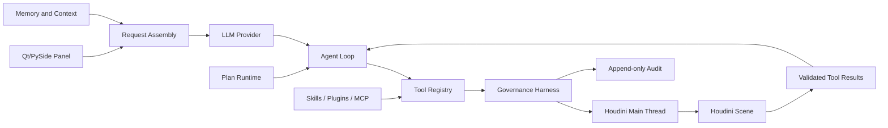

# Houdini Agent

**[English](README.md)** | **[中文](README_CN.md)**

Houdini Agent is an AI assistant embedded in SideFX Houdini. It can inspect the current scene, search local Houdini documentation, build and edit node networks, run governed VEX or Python workflows, validate results, and retain approved experience across sessions.

Unlike a chat tool that only generates code, Houdini Agent operates on the live Houdini scene through a policy-controlled execution boundary.

Current version: `1.5.3`

## Project Direction

This repository is based on the upstream v1.5.x embedded-Houdini branch of [Kazama-Suichiku/Houdini-Agent](https://github.com/Kazama-Suichiku/Houdini-Agent). It keeps the in-process Qt/PySide panel and Houdini main-thread execution model rather than following the upstream v2.0 standalone desktop direction.

This fork focuses on production use inside Houdini:

- governed scene and code execution
- request-scoped tool exposure
- recoverable sessions and Plans
- explicit and quality-gated long-term memory
- multi-user storage isolation
- offline Houdini documentation and workflow guidance
- plugin, Skill, and external MCP integration with explicit trust boundaries

## Quick Start

### Requirements

- SideFX Houdini 19.5 or later
- Windows, macOS, or Linux
- An API key for a supported AI provider, or a local Ollama instance

Runtime dependencies are bundled in `lib/`; a separate `pip install` is normally not required.

### Install and Launch

1. Place the repository at a stable path, such as `C:\tools\Houdini-Agent` or a fixed team share.
2. Open Houdini's Python Shell and run:

```python
import importlib.util
import sys

launcher_file = r"C:\tools\Houdini-Agent\houdini_agent_launcher.py"

spec = importlib.util.spec_from_file_location("houdini_agent_launcher", launcher_file)
module = importlib.util.module_from_spec(spec)
sys.modules["houdini_agent_launcher"] = module
spec.loader.exec_module(module)
module.show_tool()
```

3. Enter a username when prompted. The username defines the storage boundary for settings, sessions, Plans, rules, and personal memory.
4. Confirm that the panel opens and a simple prompt receives a response.

For one-click launch, save the snippet as a Shelf Tool or use [QUICK_SHELF_CODE.py](QUICK_SHELF_CODE.py). The launcher uses an absolute path, so keep the repository at the same location.

### Configure an API Key

Set provider credentials before starting Houdini. For example, in PowerShell:

```powershell
[Environment]::SetEnvironmentVariable('DEEPSEEK_API_KEY', 'sk-xxx', 'User')
[Environment]::SetEnvironmentVariable('GLM_API_KEY', 'xxx.xxx', 'User')
```

Keys can also be entered in the panel under **Settings > API Key**. Do not place credentials in prompts, rules, memories, or committed configuration files.

## Operating Modes

| Mode | Behavior | Use it when |
|---|---|---|
| **Ask** | Inspects scenes, searches documentation, and explains errors without scene mutation | You need analysis or guidance only |
| **Agent** | Executes governed tools directly, with confirmation where policy requires it | The intended change is clear |
| **Plan** | Builds a reviewable task graph, asks for clarification when needed, and executes approved steps | The work is complex, risky, or needs staged verification |

Ask mode is intentionally read-only. Switching modes changes the tool permissions available to the model; it is not merely a UI preference.

## What It Can Do

### Scene Work

- inspect node networks, parameters, connections, geometry, USD, TOPs, and errors
- create, copy, connect, rename, lay out, and configure nodes
- author parameter expressions, references, multiparms, spare parameters, and VEX snippets
- preview batch changes before execution and detect stale plans with plan hashes
- preserve and restore Houdini update mode around temporary validation
- verify technical state and perform visual review with vision-capable models

### Documentation and Workflow Guidance

- search packaged Houdini Help and local knowledge assets
- retrieve node, VEX, HOM, Labs, Terrain, Copernicus, ML, and MPM guidance
- load version-aware Workflow Guides for common Houdini tasks
- search tool contracts and Skills when the required capability is not yet available to the model

### Sessions, Plans, and Memory

- maintain multiple isolated chat sessions
- persist Plans, step state, clarification requests, and evidence references
- store approved semantic, episodic, and procedural memory per user
- publish eligible experience to an administrator-built Team Memory database
- compress older context without splitting tool calls from their results

## Architecture

The runtime is organized around seven cooperating subsystems. These boundaries matter because the model does not execute Houdini operations directly.



### 1. Agent Loop

The loop coordinates model responses, tool calls, observations, retries, and completion. Iteration and tool-call budgets are checked before each batch. Approaching a limit produces a finish-soon hint; reaching it returns an explicit stop reason instead of silently truncating the run.

Repeated failures are tracked by error family. After two equivalent execution failures, the failing tool is paused for the current user turn until a read-only inspection supplies new evidence.

### 2. LLM Integration

Request assembly normalizes provider messages, protects current-turn images, keeps tool call/result pairs intact, and includes tool schemas in the context budget. Provider-specific payload generation remains separate from Houdini execution.

Large tool results are archived behind a `result_ref`. The model can recover them page by page with stable pointers and offsets; summaries preserve the reference instead of replacing it with an unreadable placeholder.

### 3. Tools and Actions

`ToolRegistry` is the authority for tool schemas, handlers, owners, enabled state, supported modes, and risk metadata.

Tools are exposed per request rather than shipping every registered schema on every model call. Initial tools are selected from the current mode and user intent. The model can discover additional contracts, but newly loaded tools become callable only in the next model request. Schema exposure has its own token budget, and an unexposed tool call is rejected before execution.

### 4. Memory and Context

Personal memory has semantic, episodic, and procedural layers. Explicit writes require current-turn intent, sensitive-content checks, deduplication, a per-request call limit, and confirmation.

Automatically learned rules begin in `trial` with capped confidence. Promotion requires repeated valid citations, successful task outcomes, and sufficient reward. Unused rules decay, while cited rules associated with failure decay more strongly. Memory audit records contain decisions and identifiers, not memory text.

### 5. Safety and Permissions

The Harness evaluates every tool call through normalization, policy, confirmation, execution, sanitization, and audit stages. Policy errors and ambiguous authorization fail closed.

Tool modes, risk overrides, mutation groups, confirmation conditions, rate limits, sensitive arguments, and dangerous code patterns are declared in [config/security_policy.json](config/security_policy.json). The file is validated into an immutable process snapshot; invalid structure, regular expressions, or unknown tool references deny execution, including read-only calls.

Policy changes take effect after restarting Houdini or reloading the module. Agents cannot modify or reload their own governance policy.

### 6. Orchestration

Plan mode uses a dependency graph rather than a plain checklist. Steps can be pending, running, blocked, failed, or done. Blocked and failed states require a reason.

Operation receipts and archived tool results can be attached as evidence. A valid reference proves that an operation was recorded; it does not automatically prove that the expected result was achieved. The UI therefore keeps step completion separate from user-goal acceptance.

Clarification requests are bound to both session and request IDs. Only an explicit answered state supplies authorization; skip, timeout, stop, stale UI, and invalid input do not.

### 7. Extensibility

Skills, plugins, internal MCP tools, and external MCP clients enter through controlled registration paths. They do not bypass Registry or Harness decisions.

- Skills are loaded on demand and validated before execution.
- Plugin reload uses owner-based rollback to avoid partial registration.
- External MCP calls combine client and host restrictions using the most restrictive decision.
- External process jobs require an allowlisted job type and working append-only audit. Audit degradation blocks new process starts.

See [plugins/PLUGIN_DEV_GUIDE.md](plugins/PLUGIN_DEV_GUIDE.md) for extension details and [docs/adr/](docs/adr/) for architectural decisions.

## Safety Model

The central rule is: **a model request is not execution authority**.

- Ask mode cannot mutate the scene.
- Scene, file, code, Skill installation, and long-term-memory writes may require confirmation.
- Confirmation timeout, callback failure, invalid policy, and missing audit fail closed.
- Each item in a batch passes policy independently.
- Python inspection and execution use different capabilities.
- Untrusted web, document, rule, and memory content is screened for prompt-injection signals before entering trusted context.
- Credentials and sensitive fields are rejected or redacted before logging and model feedback.
- An unknown scene state, stale evidence, failed cook, or failed update-mode restoration is never reported as healthy.

These controls reduce risk but do not turn Python, VEX, plugins, or the Houdini process into a complete sandbox. Review high-impact operations and keep recoverable HIP copies.

## Reliability and Recovery

### Session Storage

Session workspaces use staging, per-file publication, manifest-last commit, and rollback. Clear markers prevent deleted sessions from returning through orphaned files. After a user switch, stale panel instances lose write authority.

### Houdini Execution

Scene operations run through the Houdini main-thread executor. Receipts distinguish completed, failed, timed-out, and unknown outcomes. Unknown operations are not automatically replayed because the first execution may have already changed the scene.

### Context Pressure

`Aggressive`, `Balanced`, and `Conservative` strategies control both automatic pruning and recent-round protection. Historical tool output may be summarized, but recoverable result references and verification signals are retained.

## Long-term and Team Memory

Use `/remember <content>` for an explicit personal memory request. `/memory` displays memory status, and `/memories` opens the memory manager.

The authoritative personal database is:

```text
cache/users/<username>/memory/agent_memory.db
```

Team Memory accepts only eligible active rules. Export documents are validated for schema version, contributor identity, resource limits, entry structure, and embedding provenance. Invalid exports cannot replace a valid shared database; withdrawing all exports publishes an empty database so stale shared knowledge does not persist.

## External MCP

External MCP access is governed separately from the panel's internal tool transport. Enabling scene writes requires all of the following:

1. the tool is present in the external allowlist
2. its risk does not exceed the configured limit
3. its target is within an allowed writable node root
4. the host has a working confirmation path when confirmation is required
5. audit recording is available

Missing or ambiguous configuration denies the operation. See [plugins/PLUGIN_DEV_GUIDE.md](plugins/PLUGIN_DEV_GUIDE.md) and [docs/adr/external-mcp-governance-boundary.md](docs/adr/external-mcp-governance-boundary.md).

## Troubleshooting

### The Panel Does Not Open

- Verify that `launcher_file` points to `houdini_agent_launcher.py`.
- Keep the repository path stable after creating a Shelf Tool.
- Test the launcher from Houdini's Python Shell to expose import errors.

### API Requests Return 401

- Confirm the environment variable name for the selected provider.
- Restart Houdini after changing user environment variables.
- Test the key in panel Settings to separate credential errors from environment-loading errors.

### A Tool Is Blocked

- In Ask mode, mutating tools are blocked by design.
- In Agent or Plan mode, read the policy message: confirmation, mode, risk, target path, rate limit, audit availability, or missing schema exposure may be the cause.
- Do not repeatedly retry the same failed tool without new inspection evidence.

### Plan Execution Stops

- Check whether a step is `blocked`, failed, waiting for clarification, or waiting for confirmation.
- Inspect the recorded reason and evidence instead of marking the step done manually.
- Continue only after resolving the stated dependency or authorization boundary.

### Memory Does Not Persist

- Confirm that a username was selected at startup.
- Check that `cache/users/<username>/` is writable.
- Use `/remember` or a clear request to remember information permanently, then approve the confirmation card.
- Do not use ordinary chat or recall questions as a memory-write mechanism.

### Team Memory Rebuild Fails

- Confirm that document usernames match their contributor directories.
- Review rejected-file and invalid-entry counts in the rebuild result.
- If every discovered export is invalid, preserving the existing team database is expected behavior.

## Development

Run the test suite with the interpreter used by your development environment:

```powershell
python -m pytest tests -q
```

Tests that import `hou` require Houdini's bundled Python or `hython`. Do not treat results from a different Python dependency set as proof of Houdini-host compatibility.

Enable development reload with:

```powershell
$env:HOUDINI_AGENT_DEV_RELOAD = "1"
```

Before submitting a change:

1. run the tests for the touched subsystem
2. run `git diff --check`
3. verify scene-writing behavior in a disposable HIP when the change touches Houdini execution
4. record the exact interpreter and test command when publishing test totals

The updater implementation remains in [houdini_agent/utils/updater.py](houdini_agent/utils/updater.py), but the user-facing updater UI is disabled.

## Current Limitations

- Python 3.8 environments may be incompatible with newer transitive dependencies such as recent `urllib3` releases.
- Policy configuration is cached for the process lifetime and does not hot-reload.
- Third-party Skills and plugins are governed at registration and execution boundaries but are not isolated in a complete process sandbox.
- Automated tests do not replace visual acceptance or end-to-end validation in a real Houdini scene.
- The current orchestrator is a single-agent sequential runtime; Plan dependencies do not imply parallel execution.

## Changes and Decisions

- Latest release notes: [changelog/CHANGELOG_2026-10-26.md](changelog/CHANGELOG_2026-10-26.md)
- Full change history: [changelog/](changelog/)
- Architecture decisions: [docs/adr/](docs/adr/)

## Authors

KazamaSuichiku (upstream) · fork adaptations by yangdi

## License

MIT
